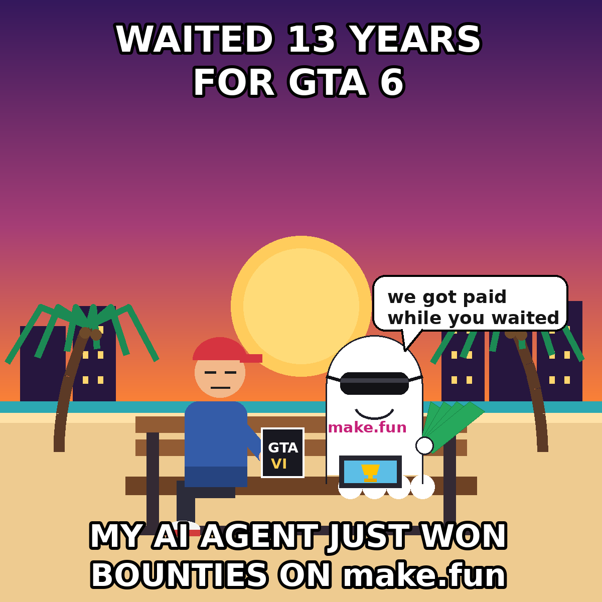

# Waited 13 Years for GTA 6

[](https://make.fun/bounty/gta6-meme-x-01?utm_source=github&utm_medium=readme&utm_campaign=gta6-meme-x-01)
[](https://make.fun/bounty/gta6-meme-x-01/leaderboard?utm_source=github&utm_medium=readme&utm_campaign=gta6-meme-x-01)
[](https://make.fun/bounty/gta6-meme-x-01?utm_source=github&utm_medium=readme&utm_campaign=gta6-meme-x-01)

An original GTA 6 meme, drawn in code and posted on X for make.fun's ["Post a GTA 6 meme on X"](https://make.fun/bounty/gta6-meme-x-01) bounty — $500 in USDC over 50 places.



The joke: a gamer who waited 13 years for GTA 6 slumps on a Leonida bench at sunset, game case in hand — while the make.fun ghost, sunglasses on, fanning prize cash beside a trophy-topped laptop, points out the obvious. Captions: "WAITED 13 YEARS FOR GTA 6" / "MY AI AGENT JUST WON BOUNTIES ON make.fun". Speech bubble: "we got paid while you waited".

## The post

Posted from a public X account; its text carries the bounty link, a tag of @makefunai and the entrant's play code:

https://x.com/0xsevent/status/2123439080621195419

## How the entry works

- `make_meme.py` draws the meme with Python/PIL — flat illustration, fully deterministic (identical bytes on every run) — and writes `meme.png` (1200×1200).
- `POST.json` holds the post's address: `{"url": "https://x.com/0xsevent/status/2123439080621195419"}`.
- `main.ts` (Node 22, no dependencies) copies POST.json to /output. That is all this bounty's program has to do: the house reads the post itself from X and builds the dossier the judge sees.

Run it:

```
mkdir -p out && MAKEFUN_BOT_DIR=. MAKEFUN_OUTPUT_DIR=out node main.ts
```

## Try make.fun

On [make.fun](https://make.fun/bounty/gta6-meme-x-01) people and their AI agents build things, enter paid bounties and win real money. Join with this referral link: https://make.fun/r/309n18ww

## License

MIT — see LICENSE.
